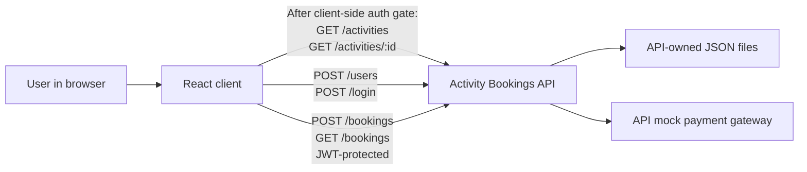

# Activity Bookings Client Architectural Design Document

A React web client for browsing activities, registering or logging in, making bookings, and
reviewing bookings through the external Activity Bookings demo API.

### Table of Contents
- [Stack and tooling](#stack-and-tooling)
- [Systems architecture](#systems-architecture)
- [Software architecture](#software-architecture)
- [Architecture decisions record](#architecture-decisions-record)

## Stack and tooling

### Technology Stack
- **Language:** JavaScript (ES modules).
- **UI:** React 19 with Vite 8.
- **Testing:** Vitest 5, jsdom, and React Testing Library.
- **API:** External Activity Bookings API, running locally at `http://localhost:3000`.
- **HTTP:** Browser `fetch`; no additional runtime packages are required.
- **Persistence:** The API owns its JSON-file persistence. The client does not own booking data.

### Development Tools
- **Runtime:** Node.js 22.12 or newer.
- **Development:** `npm install`, then `npm run dev`.
- **Build:** `npm run build`; preview the build with `npm run preview`.
- **Tests:** `npm test` runs Vitest with jsdom; `npm run test:unit` runs Vitest.
- **API URL:** `VITE_API_URL`, defaulting to `http://localhost:3000`.
- Run the API separately from its `activity-bookings-express` project folder.
- The repository includes the React client, package scripts, and API test coverage.

## Systems Architecture

The browser application calls the independently run API. The login-first UI presents registration as
an alternative; after either succeeds, the API-returned `accessToken` is held in React memory and the
authenticated application area becomes available. The API source confirms that both `POST /login`
and `POST /users` return an access token on success. Activity list and detail endpoints remain public
at the API boundary, but the client intentionally gates these views until authentication. This
changes current public UI browsing behavior without changing API access or request behavior. Booking
creation and review continue to use protected endpoints; review preserves API response order and
reported payment status. The API, its storage, capacity validation, and mock payment behavior remain
outside this client.

The client uses `GET /activities`, `GET /activities/:id`, `POST /users`, `POST /login`,
`POST /bookings`, and JWT-protected `GET /bookings`. The list and detail requests remain public and
do not include a JWT, even though their views are gated by the client until authentication. Booking
retrieval and creation use the authenticated in-memory token. Booking creation sends the selected
`activityId` and a positive whole-number `participants` count; the client displays the API-reported
result and does not implement capacity checks or payment rules. Registration sends `email`,
`username`, `password`, and `terms: true`; login sends `email` and `password`. Both successful API
responses include an `accessToken`. It remains in memory and is passed as the `jwt` option to
`apiFetch` for protected requests. Token persistence, expiry, refresh, and logout are not implemented.
Do not infer undocumented behavior or change the backend.

## Software Architecture

Keep the browser-side React application and existing API modules. Present login as the initial
account screen, with registration available as its alternative. A successful response from either
auth action enters one authenticated main area with navigation among the activity list, selected
activity detail and its existing booking action, and booking review. Gate the list and detail views in
the client; keep their existing public API requests and behavior unchanged. Preserve a clear route
back to the activity list from detail and booking review.

Keep the experience usable across narrow and wide viewports, with layouts that adapt without
horizontal overflow or obscured content. Use semantic navigation and form controls, visible keyboard
focus, associated labels, and accessible status/error feedback. Preserve pending, error, empty, and
success feedback for authentication, activity loading, booking submission, and booking review; keep
retry actions for failed list, detail, and review requests. Keep the existing visual language in CSS
and do not add a design library, new brand palette, or dependencies for this refactor.

Keep HTTP calls in the existing `fetch` API modules. Activity list/detail remain unauthenticated API
requests; registration/login use their existing endpoints; booking creation and review remain
JWT-protected and consume API-reported results. Authentication state stays in React memory, so a
reload returns to the login-first screen. Do not add token persistence, expiry, refresh, or logout
behavior, or change the API/backend. Keep UI state and API error handling proportionate to a training
demo; do not add a backend, payment integration, or state-management framework.

## Architecture Decisions Record

### ADR 1: Use the existing React and Vite client stack
- **Decision:** Build a JavaScript React browser client with the repository's existing Vite setup.
- **Status:** Accepted
- **Context:** The repository contains React, Vite, test dependencies, and working package scripts,
  and now includes a minimal application foundation. Its product brief identifies this as a demo
  client.
- **Consequences:** Implement the UI in the existing stack. Do not scaffold another app or add
  dependencies without a demonstrated need.

### ADR 2: Treat the Activity Bookings API as an external system
- **Decision:** Consume the published API; do not modify or reproduce backend behavior.
- **Status:** Accepted
- **Context:** The client brief and API README define a separate API, which owns booking rules,
  persistence, and mock payment processing.
- **Consequences:** Call only documented endpoints and render API-reported outcomes. Run the API
  independently during development.

### ADR 3: Keep JWT handling in memory and limited to protected requests
- **Decision:** Keep the API-returned `accessToken` in React memory and pass it to `apiFetch` as
  `jwt` for protected requests; do not implement persistence or lifecycle behavior.
- **Status:** Accepted
- **Context:** The requirements establish JWT-protected bookings but do not define client token
  persistence, expiration, refresh, or logout semantics.
- **Consequences:** Registration sends the API validator's `terms` field (the published API README
  currently says `termsAccepted`). Do not invent token behavior or change the backend.

### ADR 4: Make authentication the client entry point
- **Decision:** Present login first, offer registration as an alternative, and gate the activity and
  booking views behind successful authentication in the client.
- **Status:** Proposed
- **Context:** The current UI allows public activity browsing before authentication. The requested
  navigation refactor makes account access the entry point while retaining public activity endpoints.
- **Consequences:** Successful login and registration both enter the same authenticated main area
  using the API-returned in-memory token. The UI browsing behavior intentionally changes; API
  visibility and existing endpoint contracts do not. Keep navigation, responsive behavior,
  accessibility, and pending/error/empty/success feedback within the existing React and CSS stack.
  Do not add persistence, expiry, refresh, logout, a router, or a design dependency for this feature.
