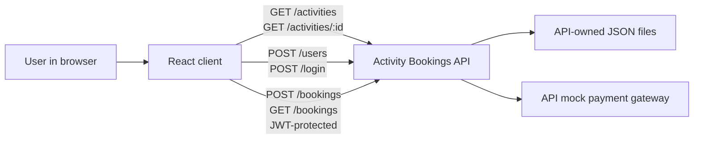

# Activity Bookings Client Architectural Design Document

A React web client for browsing activities, registering or logging in, making bookings, and
reviewing bookings through the external Activity Bookings demo API.

### Table of Contents
- [Stack and tooling](#stack-and-tooling)
- [Systems architecture](#systems-architecture)
- [Software architecture](#software-architecture)
- [Architecture decisions record](#architecture-decisions-record)

## Stack and tooling

### Technology Stack
- **Language:** JavaScript (ES modules).
- **UI:** React 19 with Vite 8.
- **Testing:** Vitest 5, jsdom, and React Testing Library.
- **API:** External Activity Bookings API, running locally at `http://localhost:3000`.
- **HTTP:** Browser `fetch`; no additional runtime packages are required.
- **Persistence:** The API owns its JSON-file persistence. The client does not own booking data.

### Development Tools
- **Runtime:** Node.js 22.12 or newer.
- **Development:** `npm install`, then `npm run dev`.
- **Build:** `npm run build`; preview the build with `npm run preview`.
- **Tests:** `npm test` runs Vitest with jsdom; `npm run test:unit` runs Vitest.
- **API URL:** `VITE_API_URL`, defaulting to `http://localhost:3000`.
- Run the API separately from its `activity-bookings-express` project folder.
- The repository includes the React client, package scripts, and API test coverage.

## Systems Architecture

The browser application calls the independently run API. Public activity requests do not require
authentication. Releases 0.1.0 and 0.2.0 implement FR1 activity discovery and FR2 account
registration/login, respectively. Registration and login use the API, and the returned
`accessToken` is held in React memory and passed to `apiFetch` as `jwt` for protected requests.
Booking workflows remain planned. The API, its storage, capacity validation, and mock payment
behavior remain outside this client.

The client uses `GET /activities`, `GET /activities/:id`, `POST /users`, and `POST /login` today;
`POST /bookings` and `GET /bookings` remain planned and require JWT authentication. Registration
sends `email`, `username`, `password`, and `terms` (true when selected); the API validator expects
`terms` although the published API README currently names `termsAccepted`. Login sends `email` and
`password`. Successful authentication returns an `accessToken`, which remains in memory and is
passed as the `jwt` option to `apiFetch`. Token persistence, expiry, refresh, and logout are not
implemented. Do not infer undocumented behavior or change the backend.

## Software Architecture

Use a small browser-side React application. Keep rendered interface and user interaction in React,
and isolate HTTP calls in the API modules using `fetch`. `src/api/client.js` provides `apiFetch`,
and `src/api/activities.js` exposes the public activity-list and activity-detail requests.

The implemented flows load `GET /activities` when browsing opens, request
`GET /activities/:id` when an activity is selected, and submit registration/login to the API. The
activity interface handles loading, empty, and request-failure states, with retry actions for failed
requests. Activity requests are public and do not include a JWT. Authentication stores the returned
`accessToken` only in React memory; protected consumers pass it to `apiFetch` as `jwt`.

Planned flows are JWT-authenticated booking creation and booking-list requests, and display of
API-reported booking/payment status. Do not add token persistence, expiry, refresh, or logout
behavior.

Keep UI state and API error handling proportionate to a training demo. Do not add a backend,
payment integration, state-management framework, or other packages without a requirement.

## Architecture Decisions Record

### ADR 1: Use the existing React and Vite client stack
- **Decision:** Build a JavaScript React browser client with the repository's existing Vite setup.
- **Status:** Accepted
- **Context:** The repository contains React, Vite, test dependencies, and working package scripts,
  and now includes a minimal application foundation. Its product brief identifies this as a demo
  client.
- **Consequences:** Implement the UI in the existing stack. Do not scaffold another app or add
  dependencies without a demonstrated need.

### ADR 2: Treat the Activity Bookings API as an external system
- **Decision:** Consume the published API; do not modify or reproduce backend behavior.
- **Status:** Accepted
- **Context:** The client brief and API README define a separate API, which owns booking rules,
  persistence, and mock payment processing.
- **Consequences:** Call only documented endpoints and render API-reported outcomes. Run the API
  independently during development.

### ADR 3: Keep JWT handling in memory and limited to protected requests
- **Decision:** Keep the API-returned `accessToken` in React memory and pass it to `apiFetch` as
  `jwt` for protected requests; do not implement persistence or lifecycle behavior.
- **Status:** Accepted
- **Context:** The requirements establish JWT-protected bookings but do not define client token
  persistence, expiration, refresh, or logout semantics.
- **Consequences:** Registration sends the API validator's `terms` field (the published API README
  currently says `termsAccepted`). Do not invent token behavior or change the backend.
