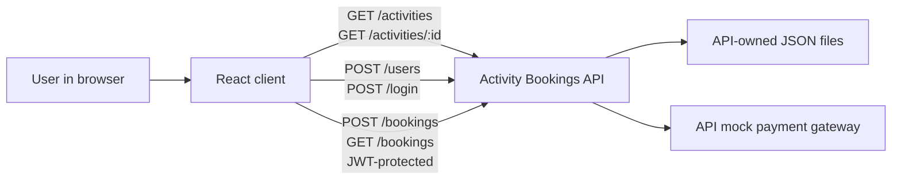

# Activity Bookings Client Architectural Design Document

A React web client for browsing activities, registering or logging in, making bookings, and
reviewing bookings through the external Activity Bookings demo API.

### Table of Contents
- [Stack and tooling](#stack-and-tooling)
- [Systems architecture](#systems-architecture)
- [Software architecture](#software-architecture)
- [Architecture decisions record](#architecture-decisions-record)

## Stack and tooling

### Technology Stack
- **Language:** JavaScript (ES modules).
- **UI:** React 19 with Vite 8.
- **Testing:** Vitest 5, jsdom, and React Testing Library.
- **API:** External Activity Bookings API, running locally at `http://localhost:3000`.
- **HTTP:** Browser `fetch`; no additional runtime packages are required.
- **Persistence:** The API owns its JSON-file persistence. The client does not own booking data.

### Development Tools
- **Runtime:** Node.js 22.12 or newer.
- **Development:** `npm install`, then `npm run dev`.
- **Build:** `npm run build`; preview the build with `npm run preview`.
- **Tests:** `npm test` runs Vitest with jsdom; `npm run test:unit` runs Vitest.
- Run the API separately from its `activity-bookings-express` project folder.
- The repository has package scripts and dependencies, but no application source yet.

## Systems Architecture

The browser application calls the independently run API. Public activity requests do not require
authentication. Registration and login use the API; the returned JWT is used for protected
booking requests. The API, its storage, capacity validation, and mock payment behavior remain
outside this client.

The client uses only the API contract for `GET /activities`, `GET /activities/:id`, `POST /users`,
`POST /login`, `POST /bookings`, and `GET /bookings`. Bookings endpoints require JWT
authentication. Request and response details must follow the API README and endpoint
specifications; do not infer undocumented behavior.

## Software Architecture

Use a small browser-side React application. Keep rendered interface and user interaction in React,
and isolate HTTP calls in a lightweight API module using `fetch`. Keep authentication data only
where needed to make the protected booking requests. Do not prescribe token persistence, expiry,
refresh, or logout behavior beyond what the API contract documents.

The main user flows are:
1. Load and display activities; load an activity by ID when its details are needed.
2. Register or log in through the API.
3. Use the returned JWT for booking creation and booking-list requests.
4. Display bookings and payment status as reported by the API.

Keep UI state and API error handling proportionate to a training demo. Do not add a backend,
payment integration, state-management framework, or other packages without a requirement.

## Architecture Decisions Record

### ADR 1: Use the existing React and Vite client stack
- **Decision:** Build a JavaScript React browser client with the repository's existing Vite setup.
- **Status:** Accepted
- **Context:** The repository contains React, Vite, test dependencies, and working package scripts,
  but no application source. Its product brief identifies this as a demo client.
- **Consequences:** Implement the UI in the existing stack. Do not scaffold another app or add
  dependencies without a demonstrated need.

### ADR 2: Treat the Activity Bookings API as an external system
- **Decision:** Consume the published API; do not modify or reproduce backend behavior.
- **Status:** Accepted
- **Context:** The client brief and API README define a separate API, which owns booking rules,
  persistence, and mock payment processing.
- **Consequences:** Call only documented endpoints and render API-reported outcomes. Run the API
  independently during development.

### ADR 3: Keep JWT handling limited to protected requests
- **Decision:** Use the JWT returned by the API for protected booking requests without specifying
  undocumented storage or lifecycle behavior.
- **Status:** Accepted
- **Context:** The requirements establish JWT-protected bookings but do not define client token
  persistence, expiration, refresh, or logout semantics.
- **Consequences:** Follow the API's published authentication details; do not invent token behavior.
